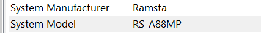
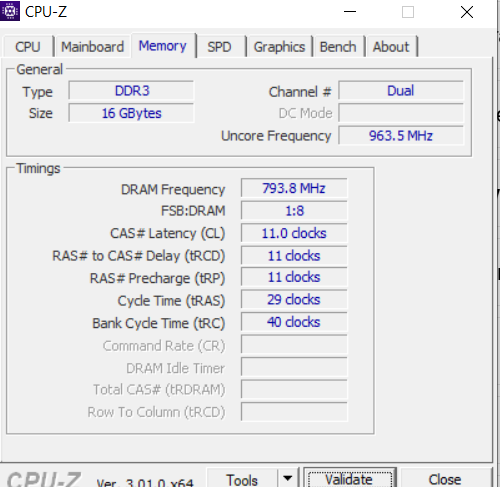
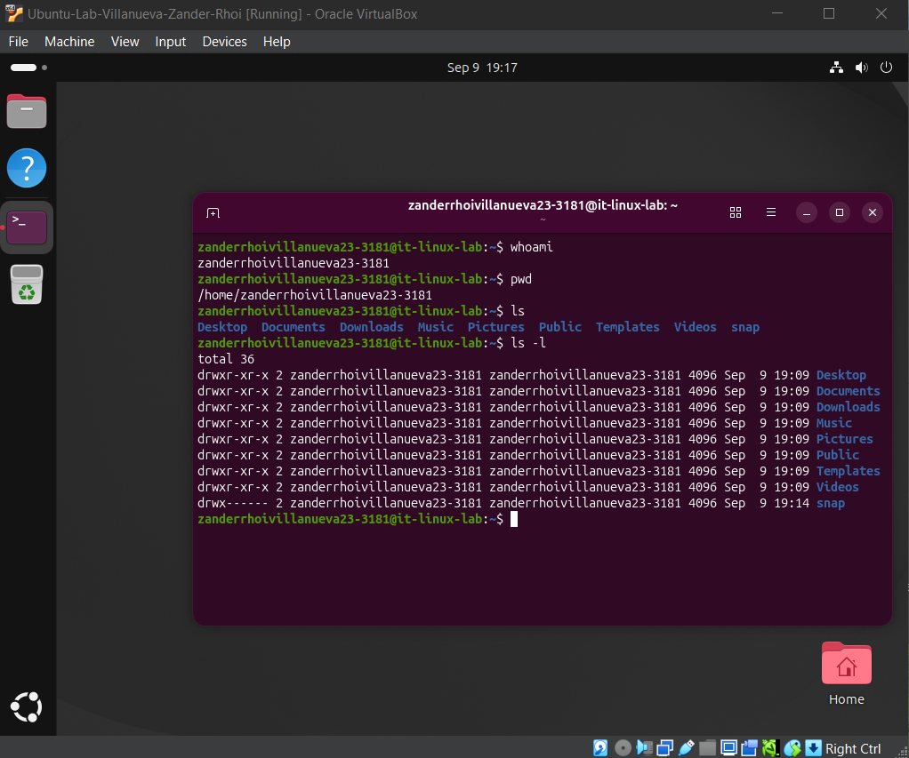
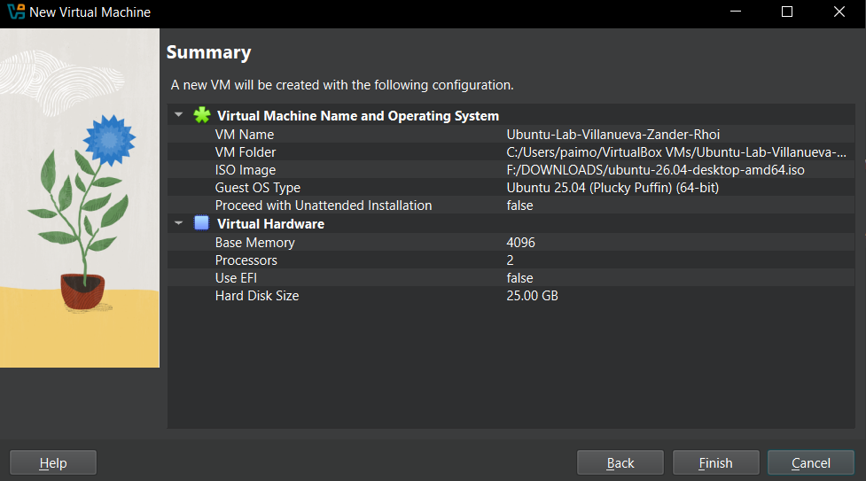
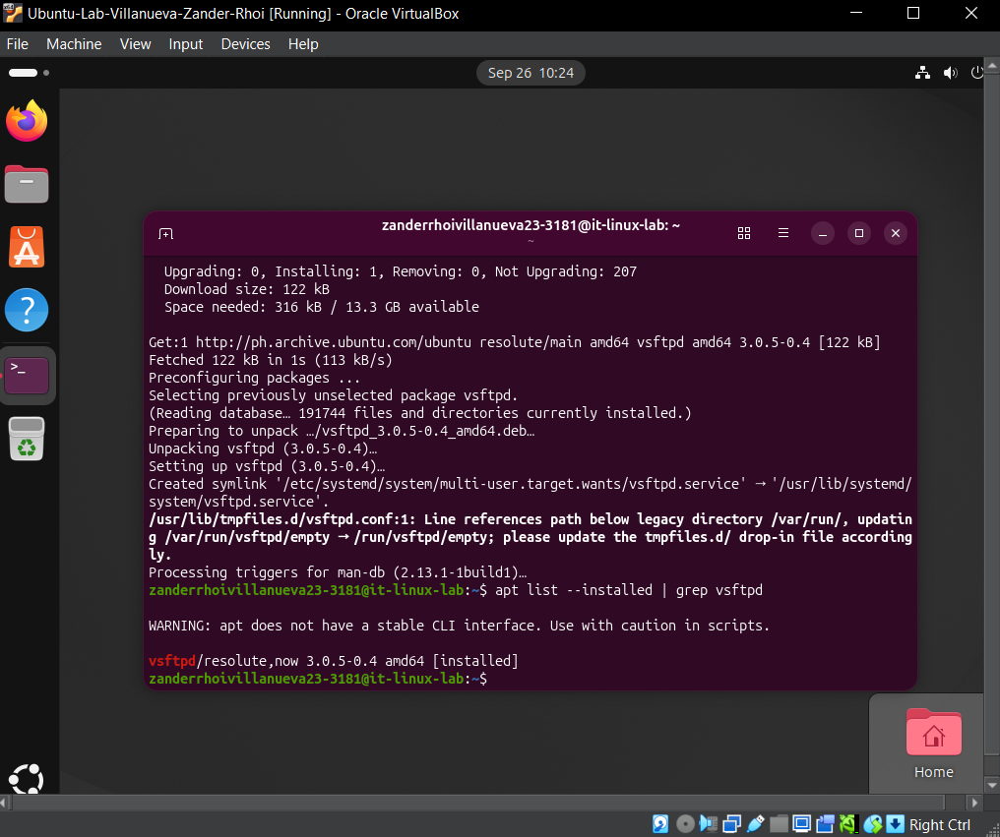
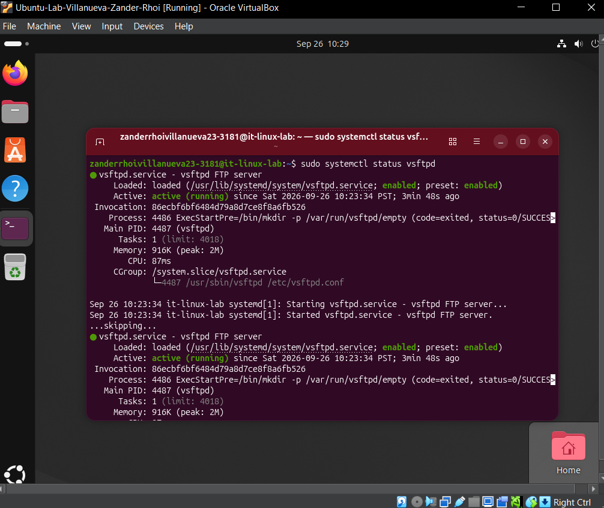
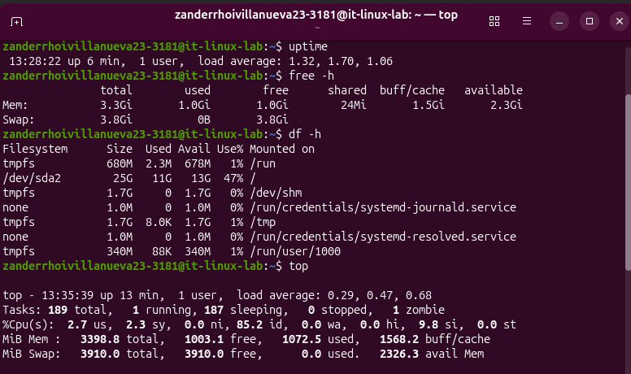

## 1. Mission Briefing
A comprehensive series of 4 intensive system administration laboratory experiments and activities executed on Ubuntu Linux and Windows CLI environments. The project covers foundational UNIX principles, advanced shell scripting, storage partition management, package repository maintenance, and user authentication policies.

## 2. Experimental Modules Executed

### Module 01: Host Hardware & Architecture Telemetry
* System diagnostics using Windows Management Instrumentation Command-line (`wmic`) and CPU-Z to document RAM topology, core thread allocation, and memory timings.
* Cross-referencing physical silicon configurations against manufacturer datasheets.

*Fig 1.1: Automated WMIC hardware audit and memory slot mapping.*

*Fig 1.2: CPU-Z memory timing analysis and SPD bus telemetry verification.*

### Module 02: Linux Storage & Filesystem Architecture
* Configured logical block devices, directory permission masks (`ls -l`, `chmod`, `chown`), and user context switches (`whoami`, `su`).
* Administered partition formatting, mounting workflows, and storage quota enforcement.

*Fig 2.1: File permission matrix and ownership delegation in bash.*

*Fig 2.2: Terminal summary configuration and storage mounting audit.*

### Module 03: Shell Scripting & Automated Diagnostics
* Authored custom Bash scripts for automated health checks, disk utilization alerts (`df -h`), and memory monitoring (`free -m`).
* Utilized cron automation to trigger scheduled maintenance scripts and system logs.

*Fig 3.1: Interactive bash diagnostic utility and memory utilization alerts.*

*Fig 3.2: Automated shell execution logs and error recovery pipeline.*

### Module 04: Server Package Storage & Repository Configuration
* Managed package caches via `apt` and `dpkg`, configured custom PPA mirrors, resolved broken dependency trees, and secured root account privileges through `sudoers` editing (`visudo`).

*Fig 4.1: Debian/Ubuntu package repository indexing and dependency resolution.*
