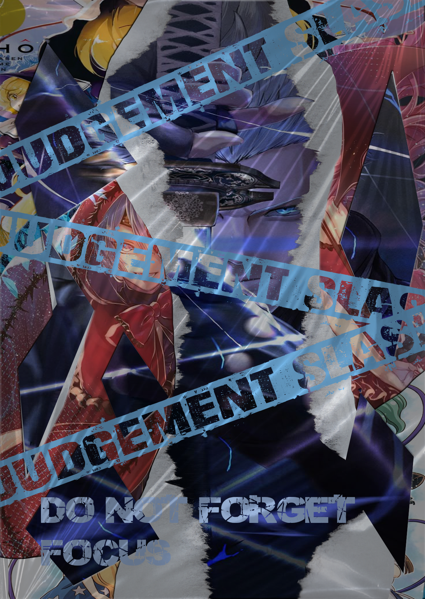
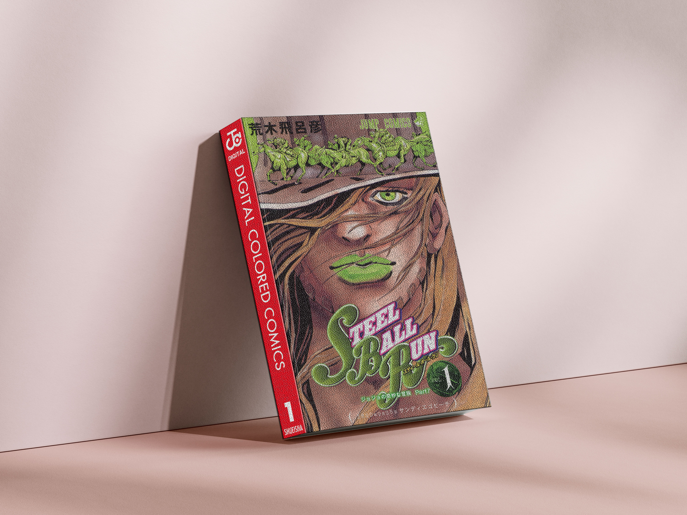
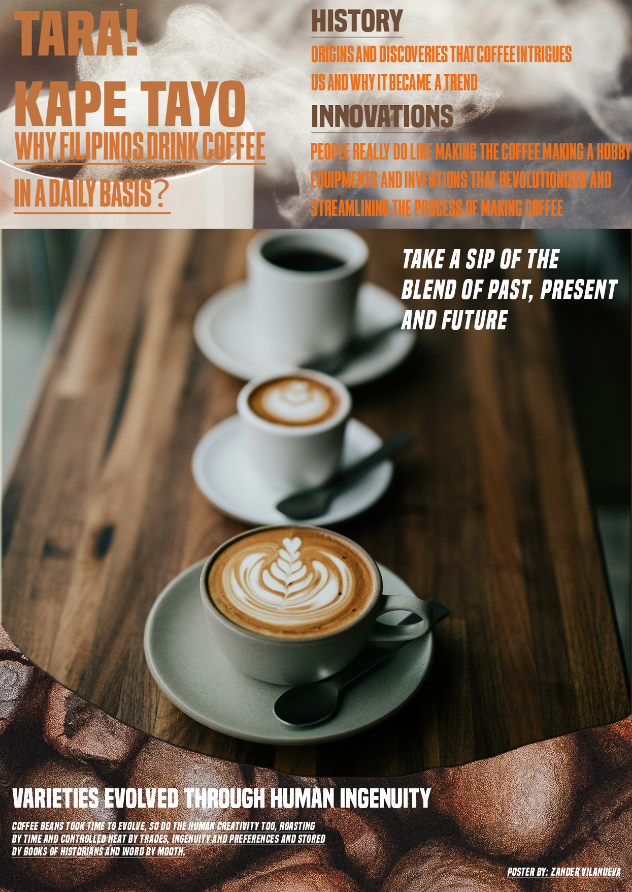
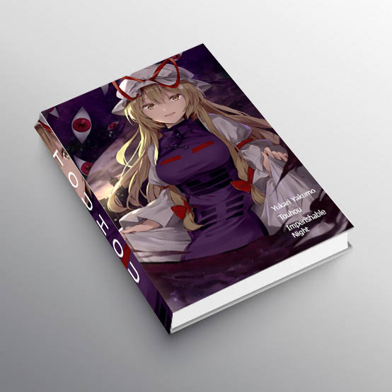
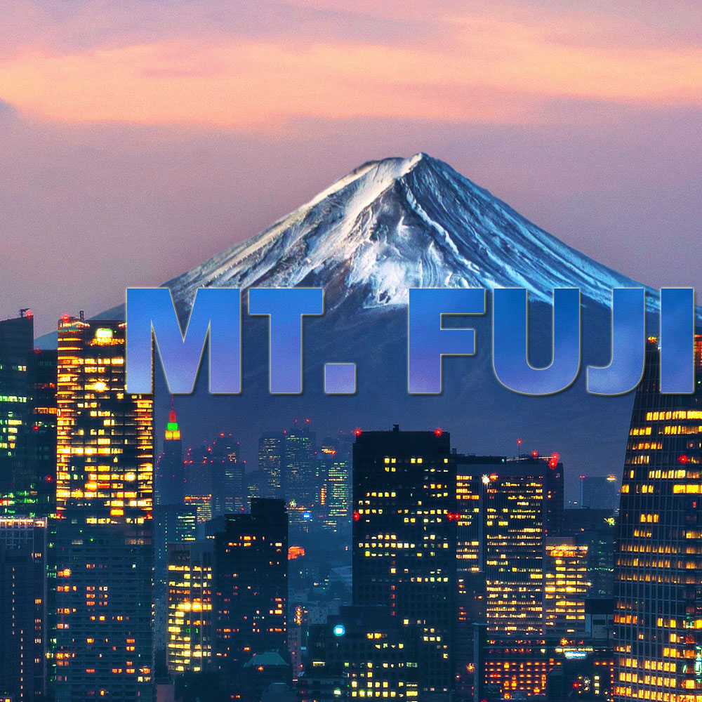
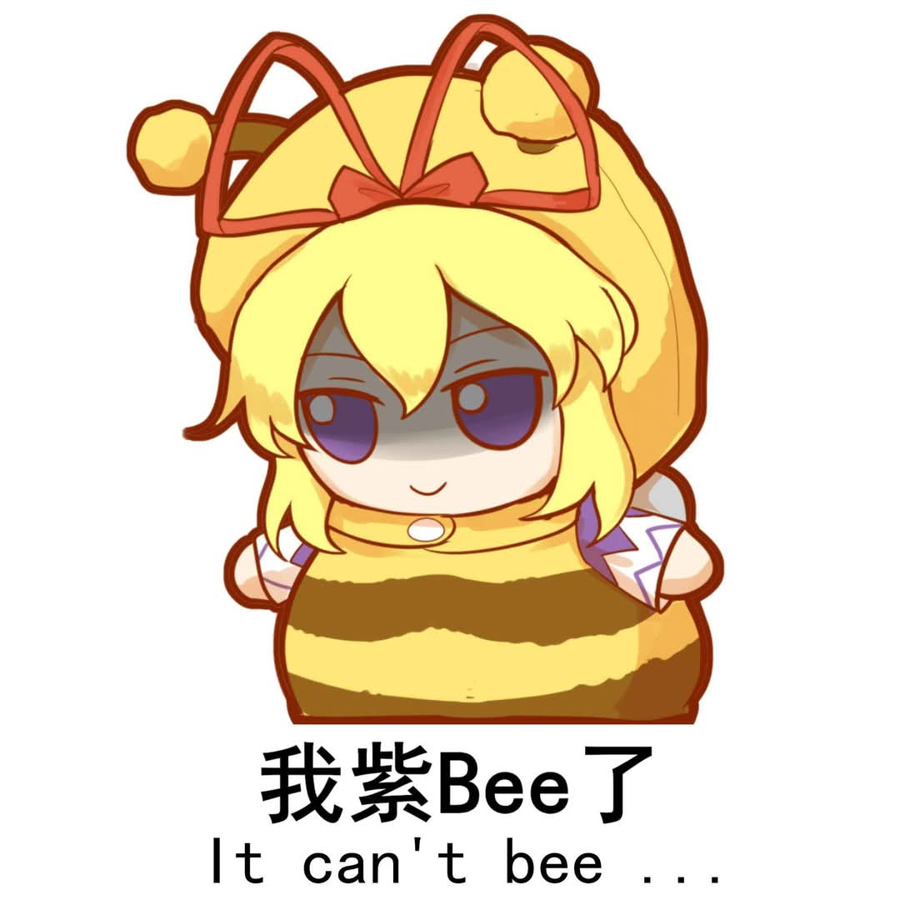

## 1. Mission Briefing
A curated visual showcase of graphic design experiments, smart object layering studies, manga cover mockups, and digital illustrations produced using Adobe Photoshop and Ibis Paint. Includes the *Judgment Slash* grunge design poster, *Steel Ball Run* manga book cover mockup, *Tara Kape Tayo* coffee poster, and *MT Fuji* layer compositions.

## 2. Visual Artifact Archive

### Artifact 01: Judgment Slash (Grunge Poster Composition)

*Mixed-media high-contrast grunge poster typography design with distressed textures and dynamic character focal points.*

### Artifact 02: Steel Ball Run (Manga Cover Art Mockup)

*High-impact editorial manga cover typography design and vintage halftone aesthetic.*

### Artifact 03: Tara Kape Tayo (Coffee Typography Poster)

*Warm vintage vector/typography poster exploring retro color palettes and branding typography.*

### Artifact 04: Yukari Yakumo Themed Book Mockup

*Book binding and cover presentation mockup combining fantasy aesthetics with clean editorial alignment.*

### Artifact 05: Smart Object & Layering Experiment

*Photoshop smart object transformation study manipulating light balance, layer masks, and gradient maps.*

### Artifact 06: Mount Fuji Vector & Layer Study

*Atmospheric landscape composition exploring depth of field, atmospheric haze, and color banding.*

### Artifact 07: Cirno Bee Illustration

*Character vector illustration and color rendering test.*
